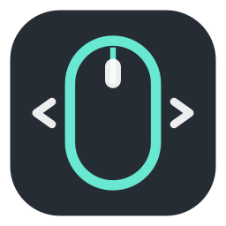

<div align="center">
  
  <h1>mx3-lite</h1>
  <p><strong>Make your MX Master 3 or 3S feel at home on macOS without keeping Logi Options+ running.</strong></p>
  <p>Desktop gestures, smooth scrolling, useful side buttons, and a measured 0% idle CPU worker in native Swift.</p>

  <p>
    <a href="https://github.com/KulmanD/Mx-Master-3-For-mac-lightweight-swiftBased/actions/workflows/test.yml"></a>
    <a href="LICENSE"></a>
    
    
  </p>

  <p>
    <a href="#installation">Installation</a>
    &middot;
    <a href="config/README.md">Terminal and configuration guide</a>
    &middot;
    <a href="LICENSE">MIT License</a>
  </p>
</div>

## Why mx3-lite

mx3-lite gives you the MX Master controls that matter every day without a large
software suite sitting in the background. Start it when you need it, close the
settings window, and let the small worker handle your mouse.

- Native Swift worker and SwiftUI settings app
- Gesture button desktop switching and Mission Control
- Back and forward side button mappings
- Scroll reversal and smoothing limited to the MX Master
- MacBook trackpad scrolling and gestures left unchanged in the recommended mode
- Manual Start and Stop with no automatic login item
- No account, telemetry, advertisements, updater, or runtime network access
- No Electron, Node.js, Python runtime, kernel extension, or persistent IPC socket
- No normal mode background log, polling loop, or periodic status timer

## Performance

The settings app does not need to stay open. Once you click **Start**, only the
small event driven worker remains. In one controlled 150.086 second idle run,
the worker used **0.000% of one CPU core** and its memory stayed flat.

| What matters | Measured result | In plain language |
| --- | ---: | --- |
| Idle CPU | `0.000%` | No CPU time or wakeup growth was recorded during the idle test |
| Worker memory | about `10.6 MB` RSS | The memory reported for the worker stayed flat |
| Physical memory footprint | about `3.4 MB` | The smaller physical footprint also stayed flat |
| Worker file size | `0.43 MB` | The complete release helper is smaller than half a megabyte |
| Core code segment | `0.21 MB` | Equal to the frozen performance baseline |
| Worker threads | `2` | Stable throughout the test |
| Idle wakeups | `0` | No recorded background wakeups |
| Network connections | `0` | The worker has no runtime network path |
| Normal mode log files | `0` | It does not create a background log in normal use |

The exact memory readings were 10,600,448 bytes RSS and 3,375,584 bytes physical
footprint. RSS and physical footprint measure different things, so they should
not be added together. Results can differ by Mac, macOS version, mouse activity,
and configuration.

See the [complete candidate report](docs/performance/final-feature-candidate.md)
and [performance release matrix](docs/performance/performance-release-matrix.md)
for the test environment, method, limitations, and feature by feature evidence.

## How it compares

mx3-lite is intentionally focused. The other tools below provide broader mouse
or Logitech features. Resource numbers are shown only for mx3-lite because this
project has not measured the alternatives under the same conditions.

| Tool | Best fit | CPU and memory evidence here | Main difference |
| --- | --- | --- | --- |
| **mx3-lite** | MX Master 3 and 3S owners who want gestures, side buttons, and tuned scrolling with a very small worker | `0.000%` idle CPU and about `10.6 MB` RSS in the recorded test | Free, MIT licensed, local, and deliberately limited to essential controls |
| [Logi Options+](https://www.logitech.com/en-us/setup/ergosetup/logi-options.html) | People who want Logitech's complete device software, application settings, Flow, and Smart Actions | Not measured by this project | Official and much broader, including Logitech hardware and account based features |
| [Mac Mouse Fix](https://github.com/noah-nuebling/mac-mouse-fix) | People who want trackpad style gestures and navigation for many standard mice | Not measured by this project | Broader mouse support; some proprietary mouse buttons may not be recognized |
| [SteerMouse](https://plentycom.jp/en/steermouse/) | People who want detailed button, wheel, cursor, and application specific controls across many mouse brands | Not measured by this project | Commercial utility with much wider customization |

## Features

| Control | What it does |
| --- | --- |
| Move left while holding the gesture button | Switch desktops; direction can be reversed in Settings |
| Move right while holding the gesture button | Switch desktops; direction can be reversed in Settings |
| Move up while holding the gesture button | Open Mission Control |
| Move down while holding the gesture button | Send Control + Down, or disable the action |
| Back button | Send Command + `[` |
| Forward button | Send Command + `]` |
| Main wheel | Reverse direction, adjust speed, and smooth movement |
| Ratchet and free spin modes | Dampen sudden bursts and limit large steps |
| Settings app | Start or stop the worker and change gesture, button, and scroll settings |
| Diagnostics | Check permissions, configuration, worker status, and mouse detection without changing anything |
| Terminal tools | Optional `mxmaster` command, event inspector, live debug, and direct shortcut tests |

Only one action is sent during each gesture button hold. The default movement
threshold is intentionally conservative to reduce accidental desktop switches.

## Compatibility and validation

- Requires macOS 12 Monterey or newer.
- Builds are validated for Apple Silicon (`arm64`) and Intel (`x86_64`).
- The final candidate was physically tested on one Logitech MX Master 3S with
  macOS 26.5.1.
- That test covered gestures, side buttons, ratchet and free spin scrolling,
  reversal, pause/resume, trackpad coexistence, mouse reconnect, power cycle,
  sleep/wake recovery, and worker lifecycle.
- MX Master 3 support is implemented and expected, but the final validation
  matrix was not repeated on an MX Master 3.

This is evidence from one device, not a universal compatibility claim.
Button IDs can differ by connection, so diagnostics and inspector mode are
available when the defaults do not match another setup.

## Installation

### Current distribution status

There is no prebuilt application download yet. The old validation releases were
removed because they were not the final version. Until a Developer ID signed
and notarized release is available, install the current source using the steps
below.

### Install the native app from source

1. Open **Terminal** from Applications > Utilities.
2. Install Apple's command line developer tools if they are not already present:

   ```sh
   xcode-select --install
   ```

   If macOS says the tools are already installed, continue to the next step.

3. Clone the project:

   ```sh
   git clone https://github.com/KulmanD/Mx-Master-3-For-mac-lightweight-swiftBased.git
   ```

4. Enter the downloaded project folder:

   ```sh
   cd Mx-Master-3-For-mac-lightweight-swiftBased
   ```

5. Build and install the app:

   ```sh
   bash scripts/install-app.sh
   ```

6. Open mx3-lite:

   ```sh
   open "$HOME/Applications/mx3-lite.app"
   ```

The app is installed to `~/Applications/mx3-lite.app`. The optional terminal
wrapper is installed to `/usr/local/bin/mxmaster` and may ask for an administrator
password. Use `bash scripts/install-app.sh --skip-wrapper` to install only the app.

Local source builds use ad hoc signing. On first launch, macOS may require you to
Control click `mx3-lite.app`, choose **Open**, and confirm **Open**. Do not disable
Gatekeeper globally.

## macOS permissions

mx3-lite needs permission to observe the mouse and send the configured keyboard
shortcuts.

1. Open mx3-lite and select **Diagnostics**.
2. Open **Accessibility settings** and enable mx3-lite.
3. Open **Input Monitoring settings** and enable mx3-lite if macOS requires it.
4. If macOS lists the bundled `mx3-lite` helper separately, enable that entry too.
5. Quit and reopen the app after changing permissions.

The exact executable you run must have permission. Rebuilding or moving the app
can cause macOS to request permission again.

## Using the app

The mx3-lite app is a control panel for configuration. The separate worker is
the small process that handles gestures and scrolling.

1. Open mx3-lite.
2. Click **Start**. The status changes to **Running**.
3. You may now quit the settings app completely with Command + Q. The worker
   continues running on its own.
4. Use the gesture, side button, and scroll controls normally.
5. Reopen mx3-lite and click **Stop** when you want to stop completely. No worker
   remains after a successful stop.

Nothing starts automatically after login. Open mx3-lite and click **Start** when
you want to use it again.

## Settings overview

After changing a setting, click **Save**. If the worker is already running, the
app shows **Saved changes require a worker restart**. Click **Restart now** to
apply the new configuration. The **Revert** button only discards changes that
have not been saved.

| Setting | Guidance |
| --- | --- |
| Movement threshold | Start at `220`; lower triggers sooner, higher reduces accidental actions |
| Desktop direction | Reverse left/right if desktop movement feels opposite to the gesture |
| Down gesture | Choose Control + Down or disable it |
| Button IDs | Defaults are gesture `5`, back `3`, forward `4`; an empty value disables a mapping |
| Scroll transform | Keep **MX Master only** selected so the MacBook trackpad is unchanged |
| Wheel direction | Reverse vertical or horizontal scrolling independently |
| Multiplier and acceleration | Keep both at `1.0` until basic direction feels correct |
| Balanced (EMA) | Recommended responsive smoothing; factor `0.35` is the default |
| Dampen free spin spikes | Useful when large free spin bursts travel too far |
| Inertia | Experimental and optional; it can feel less immediate |
| Action backend | Keep **System Events** selected; CGEvent equivalence remains unqualified |

Use **Run diagnostics** if gestures or scrolling do not work. Diagnostics are
read only: they do not change settings or send mouse or keyboard actions.

## Troubleshooting

### Gestures do nothing

Confirm the app says **Running**, run Diagnostics, grant any missing permission,
then Stop and Start the worker. If necessary, verify that the gesture button ID
is `5` or use inspector mode from the [technical guide](config/README.md).

### Desktop direction is wrong

Change **Reverse left and right desktop direction**, save, and restart the worker.

### Gestures trigger too easily

Increase **Movement threshold** in steps of 20 until the gesture feels deliberate.

### The trackpad scroll direction changed

Set **Scroll transform** to **MX Master only**. **All pointing devices** is a
fallback that intentionally changes trackpad scrolling too.

### Scrolling feels delayed or too strong

Keep **Balanced (EMA)** selected and reduce its factor, or disable smoothing.
Return Multiplier and Acceleration to `1.0` before tuning other values.

## Privacy and architecture

The native SwiftUI app is only a temporary control panel. The separate worker
handles the mouse events, device detection, gestures, scroll changes, and
keyboard actions. After you click **Start**, you can quit the settings app and
leave only the worker running.

- Configuration stays in
  `~/Library/Application Support/mx3-lite/config.json`.
- Configuration is read once when the worker starts.
- Scroll events are modified and returned in place rather than reposted.
- Smoothing keeps a small fixed amount of state and uses no background timer in
  the normal EMA or spike damping modes.
- System Events is launched only when a mapped action actually fires.
- There is no telemetry, runtime network path, updater, login item, launch agent,
  normal mode log file, or automatic worker start.

See [Native app architecture](docs/APP_ARCHITECTURE.md) for the process and
lifecycle contract.

## Project status and limitations

mx3-lite intentionally concentrates on gestures, side buttons, and scrolling.
It is not intended to reproduce every Logi Options+ feature. It does not manage
DPI, SmartShift, HID++ hardware settings, device firmware, Logitech Flow, Smart
Actions, or application profiles.

The integrated candidate has passing CI, controlled idle evidence, and a
physical validation matrix run by the maintainer on one device. The following
work is not represented as complete:

- Official Developer ID signing, notarization, stapling, and clean machine tests
- A fixed combined active input CPU and latency benchmark
- Qualification of CGEvent as an equivalent action backend
- DPI, SmartShift, HID++ hardware configuration, profiles, and firmware support
- Broad validation across every MX Master model, connection type, and macOS release

Maintainers preparing an application download should follow the
[public release guide](docs/PUBLIC_RELEASE.md).

## Building from source

```sh
swift build
swift test
swift build -c release
bash scripts/build-app.sh
```

Build separate validation archives for Apple Silicon and Intel:

```sh
bash scripts/package-release.sh --arch arm64
bash scripts/package-release.sh --arch x86_64
```

These default to ad hoc signing and are validation artifacts, not official
public downloads. Developer ID and notarization instructions are in the
[public release guide](docs/PUBLIC_RELEASE.md). Terminal commands, configuration
fields, inspector mode, and debug tools are in the
[technical guide](config/README.md).

## Uninstall

1. Open mx3-lite and click **Stop**.
2. Quit the app.
3. Run the included uninstall scripts from the project folder:

   ```sh
   bash scripts/uninstall.sh
   bash scripts/uninstall-app.sh
   ```

The user configuration is intentionally preserved. Remove it manually only if
you also want to erase your saved settings:

```text
~/Library/Application Support/mx3-lite/config.json
```

## Contributing

Focused bug reports and reproducible hardware observations are useful,
especially when they include the mouse model, connection method, macOS version,
button IDs, and read only Diagnostics output. Run `swift test` and both debug and
release builds before proposing source changes.

The project is available under the MIT License. Open an issue before investing
in a large change.

## License

mx3-lite is available under the [MIT License](LICENSE).

## Trademark disclaimer

mx3-lite is an independent community project. Logitech does not develop,
sponsor, or support it. Logitech product names are used only to identify the
hardware and software that mx3-lite works with, and those names belong to
Logitech.
